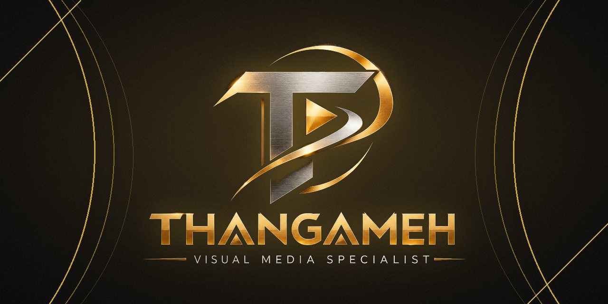

<div align="center">



<br/>

# THANGAMEH Portfolio

### *Edits that shine like gold.*

A cinematic **black-and-gold** portfolio website for **THANGAMEH**, a Visual Media Specialist (Video Editor & Graphic Designer) from Tamil Nadu, India.

<br/>

[](https://YOUR-SITE.vercel.app)
[](https://wa.me/918015169841)
[](https://www.instagram.com/thangameh.visuals)


</div>

---

## Table of Contents

1. [About the Project](#about-the-project)
2. [Brand Identity](#brand-identity)
3. [Highlights](#highlights)
4. [Website Sections](#website-sections)
5. [Work Showcase](#work-showcase)
6. [Tech Stack](#tech-stack)
7. [Getting Started](#getting-started)
8. [Project Structure](#project-structure)
9. [Updating the Content](#updating-the-content)
10. [Deployment (GitHub → Vercel)](#deployment-github--vercel)
11. [Troubleshooting](#troubleshooting)
12. [Performance, SEO & Accessibility](#performance-seo--accessibility)
13. [Roadmap](#roadmap)
14. [Copyright, Privacy & Usage](#copyright-privacy--usage)
15. [Contact](#contact)

---

## About the Project

**THANGAMEH** (*Thangam* means **gold** in Tamil) is a freelance creative brand built on one promise: every video, poster and design should look as valuable as gold.

This repository contains the source code of the brand's **single-page portfolio website**. It is built to do three jobs:

| Goal | How the site does it |
|---|---|
| **Build trust** | A premium, cinematic design, real project work and clear terms |
| **Show the work** | Video showreel with a modal player, plus a poster, frame and banner gallery with a before/after slider |
| **Convert visitors** | WhatsApp-first contact flow with prefilled messages, form to chat in one tap |

---

## Brand Identity

| Element | Detail |
|---|---|
| **Brand name** | THANGAMEH |
| **Tagline** | Visual Media Specialist |
| **Positioning** | Video Editor & Graphic Designer: cinematic edits, reels, posters, frames, banners and ad creatives |
| **Logo** | Brushed-silver **T** with a gold play button and a sweeping gold ring |
| **Core palette** | Black `#0B0B0D` · Charcoal `#14151A` · Gold `#D4AF37` · Light Gold `#F5D77A` · Dark Gold `#8C6A1A` · Off-white `#FAF6EC` |
| **Typography** | Serif display headings, clean sans-serif body, Noto Tamil fonts for Tamil mode |
| **Motifs** | Flowing gold swooshes, glossy rings, viewfinder corner brackets, timeline dividers, film grain |

---

## Highlights

- **Luxury black-and-gold design** with glassmorphism cards, gold gradient headings and soft glows.
- **Cinematic motion**: scroll reveals, parallax swooshes, 3D tilt cards, animated counters and a logo shine intro.
- **Video showreel** of 10 real projects, filterable by category, with a keyboard-friendly modal player.
- **Posters, Frames, Banners & Ad Creatives gallery** of 23 designs with category tabs, masonry layout and a zoomable lightbox.
- **Before / After slider**: an original photo or scan next to the finished poster, so clients see the transformation.
- **Full Tamil / English toggle** that translates the entire interface.
- **WhatsApp-first contact**: every call-to-action opens a prefilled WhatsApp message.
- **Data-driven content**: projects, photos, pricing, FAQs and contact details live in one place for quick edits.
- **Mobile-first and responsive**, built for the phones most clients browse on.

---

## Website Sections

| # | Section | Purpose |
|---|---|---|
| 1 | **Navbar** | Sticky glass navigation, language toggle and a **Hire Me** button |
| 2 | **Hero** | Headline, service line, trust strip and a cinematic showreel frame |
| 3 | **Tools Marquee** | CapCut, VN, InShot, Alight Motion and AI tools with years of experience |
| 4 | **Video Work** | Filterable showreel of event promos, wedding invites, motion titles and edits |
| 5 | **Posters, Frames, Banners & Ads** | Birthday, anniversary, wedding, family and devotional designs |
| 6 | **Before / After** | Interactive comparison of the original and the designed result |
| 7 | **Services** | Reels, promos, wedding videos, motion graphics, frames, posters, banners and ad creatives |
| 8 | **About** | Portrait, story and experience highlights |
| 9 | **Process** | Brief → Concept → Edit & Design → Preview → Revisions → Delivery |
| 10 | **Pricing** | Starting-from packages, revision policy and advance terms |
| 11 | **FAQ** | Turnaround, revisions, payment, formats, music copyright and languages |
| 12 | **Contact** | WhatsApp, phone, email and a form that opens WhatsApp with details prefilled |
| 13 | **Footer** | Quick links, social profiles and a back-to-top button |

---

## Work Showcase

### Video projects (10)

| # | Project | Type | Length |
|---|---|---|---|
| 01 | CYKRYPT '26 – Red & Yellow Poster-Style Promo | Event Promo | 31s |
| 02 | Cyber Security Fire-Text Promo with Drone Shots | Event Promo | 23s |
| 03 | ARAMBHIKALAMA 2025 – Technical Quiz Promo | Event Promo | 47s |
| 04 | National Conference – Next-Gen Cyber Security Teaser | Event Promo | 58s |
| 05 | Cyber Security Events Teaser – Hacker Theme | Event Promo | 74s |
| 06 | CYKRYPT '25 – Typewriter & 3D Gold Title Reveal | Event Promo | 20s |
| 07 | 3D Classroom Registration Reel | Event Promo | 12s |
| 08 | Wedding Invitation Video – Yellow & Gold | Wedding Invite | 62s |
| 09 | CYKRYPT '25 – Gold Stars Title Teaser | Motion Title | 15s |
| 10 | Tamil Hype Montage – Kinetic Captions *(fan edit / sample)* | Reels & Hype Edits | 60s |

### Design gallery (23)

| Category | Designs |
|---|---|
| Birthday | 9 |
| Family & Frames | 5 |
| Anniversary | 3 |
| Wedding, Engagement & Maternity | 3 |
| God & Devotional | 3 |

---

## Tech Stack

| Layer | Technology |
|---|---|
| Framework | **React** |
| Build tool | **Vite** |
| Styling | **Tailwind CSS** |
| Animation | **Framer Motion** *(verify against `package.json`)* |
| Video hosting | Google Drive / YouTube embeds |
| Image format | WebP, lazy-loaded |
| Hosting | **Vercel** (auto-deploy from GitHub) |
| Version control | Git & GitHub |

> Keep this table in sync with the dependencies listed in `package.json`.

---

## Getting Started

### Prerequisites

- **Node.js** 18 or newer
- **npm** (comes with Node.js)
- **Git**

### Run it locally

```bash
# 1. Clone the repository
git clone https://github.com/thangam22-cyber/thangameh.visuals-portfolio.git
cd thangameh.visuals-portfolio

# 2. Install dependencies
npm install --legacy-peer-deps

# 3. Start the dev server
npm run dev
```

Open the local address shown in the terminal (usually `http://localhost:5173`).

### Create a production build

```bash
npm run build      # outputs to /dist
npm run preview    # serves the production build locally
```

---

## Project Structure

```text
thangameh.visuals-portfolio/
├── docs/
│   └── banner.png            # README banner / GitHub social preview
├── public/
│   └── assets/               # Logo files, gallery photos, about portrait, before/after images
├── src/                      # Components, sections, styles and the central content data
├── index.html                # Page shell, SEO meta tags, favicon
├── package.json              # Scripts and dependencies
├── .npmrc                    # legacy-peer-deps=true (dependency resolution fix)
├── vite.config.*             # Vite configuration
└── README.md
```

---

## Updating the Content

All editable content (projects, photos, pricing, FAQs, contact and social links) is kept in one central data file inside `src/`, so you can update the site without touching the layout.

| I want to… | What to do |
|---|---|
| **Add a video** | Upload to YouTube (Unlisted) or Google Drive, then add an entry with `title`, `category`, `duration`, `orientation`, `videoUrl` and `thumbnail` |
| **Add a design** | Put the WebP image in `public/assets/`, then add it to the gallery data with its category |
| **Add a before/after pair** | Add `ba-XX-before` and `ba-XX-after` images (same size) and a new pair entry |
| **Change prices** | Edit the pricing entries in the data file |
| **Change contact details** | Edit the contact and social links in the data file |
| **Edit Tamil text** | Update the Tamil strings in the translations file |

### Video link formats

| Source | Embed URL |
|---|---|
| YouTube | `https://www.youtube.com/embed/VIDEO_ID` |
| Google Drive | `https://drive.google.com/file/d/FILE_ID/preview` |

> Drive videos must be shared as **Anyone with the link → Viewer**.

### Image guidelines

- Format: **WebP** (or optimized JPG), width about 1080 px, under 300 KB each.
- Name files clearly, for example `photo-01.webp`, `ba-01-before-scan.webp`.
- Keep the original aspect ratio so faces and text are never cropped.

---

## Deployment (GitHub → Vercel)

1. **Push** the code to this GitHub repository (`main` branch).
2. In **[Vercel](https://vercel.com)**, choose **Add New → Project** and import the repository.
3. Use these settings:

   | Setting | Value |
   |---|---|
   | Framework Preset | **Vite** |
   | Build Command | `npm run build` |
   | Output Directory | `dist` |
   | Install Command | `npm install --legacy-peer-deps` *(not needed if `.npmrc` is in the repo)* |
   | Environment Variables | None required |

4. Click **Deploy**. Every future `git push` to `main` redeploys the site automatically.
5. *(Optional)* Add a custom domain such as `thangameh.in` under **Settings → Domains**.

---

## Troubleshooting

| Problem | Fix |
|---|---|
| `npm error ERESOLVE` during install | Use `npm install --legacy-peer-deps`, or add a `.npmrc` file containing `legacy-peer-deps=true` |
| Vercel build fails at *Install* | Set the Install Command to `npm install --legacy-peer-deps` and redeploy |
| A video does not play | Check Drive sharing (**Anyone with the link**) or that YouTube **Allow embedding** is on |
| Images are missing after deploy | Confirm the files are inside `public/assets/` and the paths match exactly (case-sensitive) |
| Old content still showing | Hard refresh (`Ctrl + Shift + R`) and confirm the latest deployment is **Ready** in Vercel |

---

## Performance, SEO & Accessibility

- **Performance:** lazy-loaded images and iframes, WebP assets, videos loaded only when the player opens.
- **SEO:** descriptive title and meta description, Open Graph tags, semantic HTML and structured data for a professional service.
- **Accessibility:** keyboard-accessible modals, lightbox and slider, visible focus states, meaningful `alt` text, and `prefers-reduced-motion` support.
- **Mobile first:** layouts tested for small screens and touch gestures.

---

## Roadmap

- [ ] Add more before / after pairs
- [ ] Add a dedicated **Photo Frames** collection
- [ ] Replace placeholder testimonials with real client reviews
- [ ] Add a downloadable **rate card / media kit (PDF)**
- [ ] Custom domain and `og:image` social preview
- [ ] Case-study pages for featured projects
- [ ] Analytics to track visits and WhatsApp clicks

---

## Copyright, Privacy & Usage

- **© 2026 THANGAMEH. All rights reserved.** The brand, logo, designs, videos and photos in this repository are the intellectual property of THANGAMEH. Please do not copy, redistribute or reuse them without written permission.
- Client work and personal photographs are shown **with consent**. If you appear in a design and want it removed, please get in touch and it will be taken down promptly.
- Some samples (marked *fan edit / sample*) are practice work and are not for commercial use.
- Music and third-party media in showcase videos remain the property of their respective owners.

---

## Contact

<div align="center">

**THANGAMANI M** · *Visual Media Specialist, Tamil Nadu, India*

| | |
|---|---|
| **WhatsApp / Phone** | [+91 80151 69841](https://wa.me/918015169841) |
| **Email** | [thangameh.visuals@gmail.com](mailto:thangameh.visuals@gmail.com) |
| **Instagram** | [@thangameh.visuals](https://www.instagram.com/thangameh.visuals) |
| **LinkedIn** | [thangam22](https://www.linkedin.com/in/thangam22/) |
| **GitHub** | [thangam22-cyber](https://github.com/thangam22-cyber) |

<br/>

**Have a video, poster or ad in mind? Let's make it golden.**

[](https://wa.me/918015169841?text=Hi%20THANGAMEH%2C%20I%20saw%20your%20portfolio%20and%20want%20to%20discuss%20a%20project)

<sub>Crafted with care in Tamil Nadu · Black. Gold. Cinematic.</sub>

</div>
